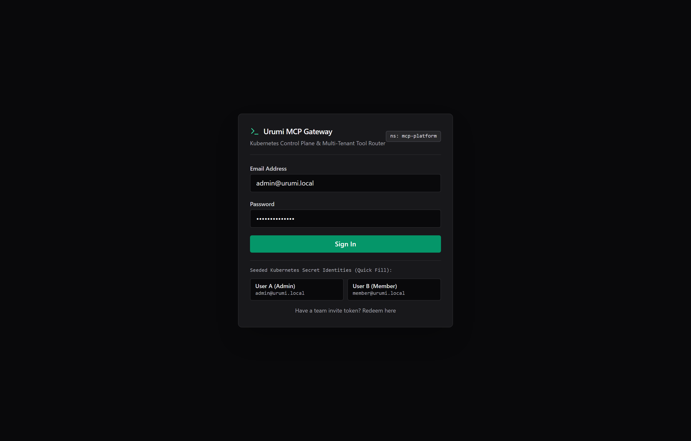
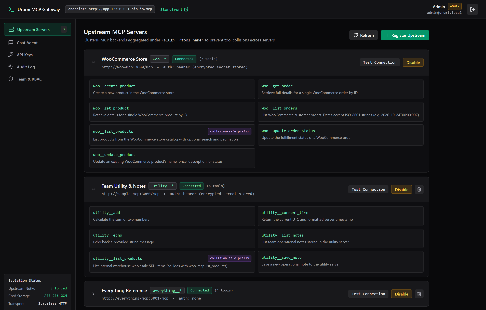
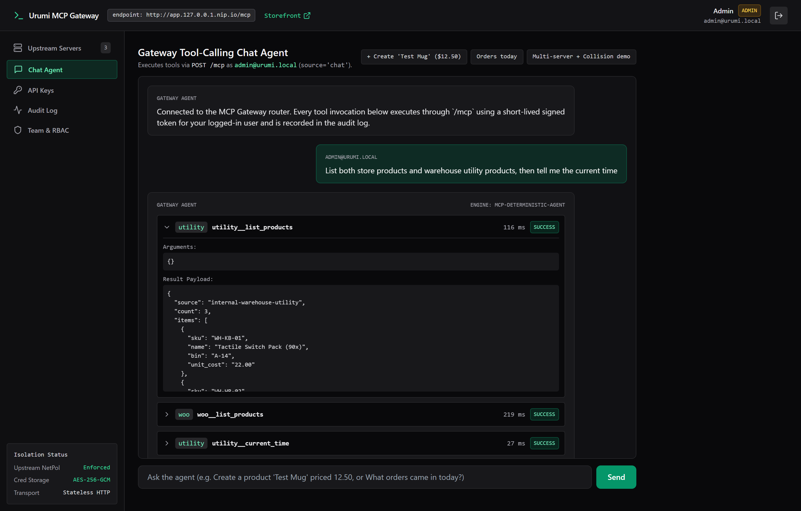
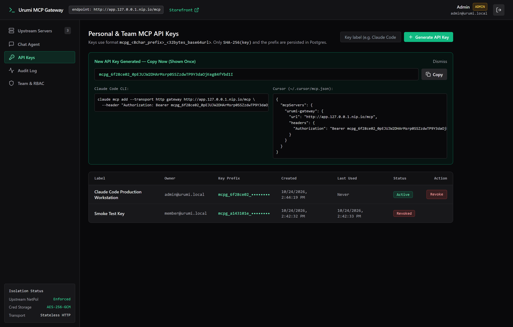
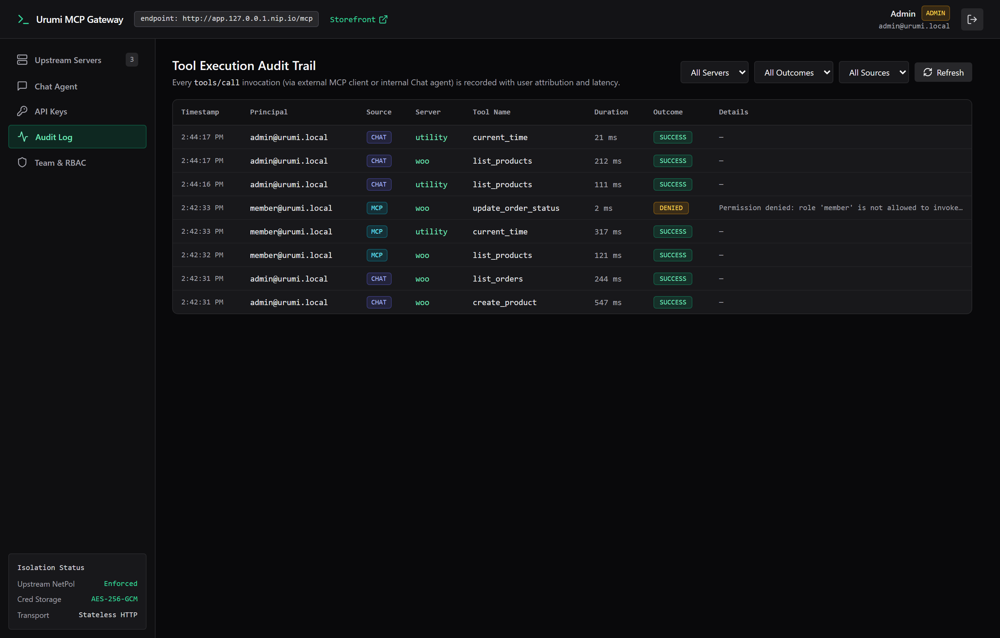
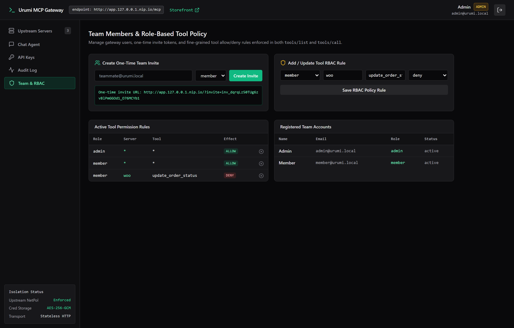
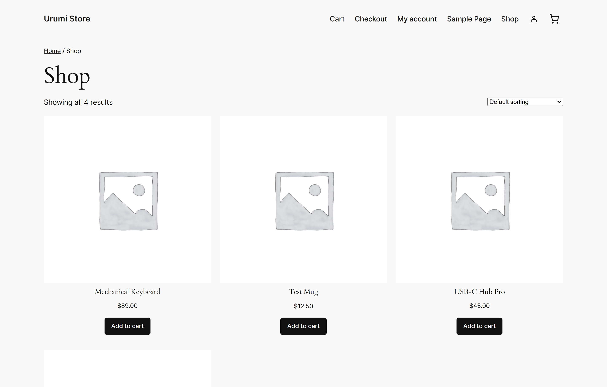

# Urumi — WooCommerce Hosting & Team MCP Gateway on Kubernetes

A Kubernetes-native e-commerce and Model Context Protocol (MCP) control plane packaged as a single umbrella Helm chart (`charts/mcp-platform`). It deploys a self-bootstrapping WooCommerce store alongside a multi-tenant MCP Gateway that aggregates internal Streamable HTTP MCP servers behind a single authenticated endpoint (`/mcp`), complete with AES-256-GCM credential encryption, SHA-256 hashed API keys, role-based tool access control (RBAC), per-server circuit breaking, Kubernetes `NetworkPolicy` isolation, and an SSE tool-calling Chat Agent.

---

## Live Prototype Tour

> **Full Narrated Architecture & Demo Video (7m 28s, 1080p MP4):** [`docs/project-demo-walkthrough.mp4`](docs/project-demo-walkthrough.mp4) ([Download / Watch Raw MP4](https://github.com/harshgupta170704/MCP-Gateway-on-Kubernetes/raw/main/docs/project-demo-walkthrough.mp4))

### 1. Control Plane Authentication & Seeded Kubernetes Identities


### 2. Upstream MCP Server Registry & Collision-Safe Tool Aggregation
Aggregates three internal `ClusterIP` MCP servers (`woo`, `utility`, and `everything`) and prefixes every tool as `<server_slug>__<tool_name>` (e.g., resolving the deliberate name collision between `woo__list_products` and `utility__list_products`).


### 3. Tool-Calling Chat Agent (`POST /api/chat` -> `POST /mcp`)
The built-in Chat Agent mints a short-lived (3-minute) HMAC-signed token for the logged-in user and calls the gateway's own `/mcp` endpoint so every tool invocation traverses the exact same authentication, RBAC, timeout, and audit code path (`source = 'chat'`).


### 4. Personal & Team API Keys (`mcpg_<prefix>_<secret>`)
Plaintext keys are displayed **once** upon generation alongside ready-to-paste snippets for Claude Code CLI and Cursor. Only `SHA-256(key)` and the 8-character hex prefix are stored in Postgres.


### 5. Real-Time Tool Execution Audit Trail
Every `tools/call` request (whether from an external MCP client or the internal Chat Agent) is recorded in `audit_log` with user identity, source (`mcp` vs. `chat`), upstream slug, tool name, latency in milliseconds, and outcome (`success`, `denied`, `error`, `timeout`).


### 6. Team Invites & Role-Based Tool Policy (`tool_permissions`)
Administrators issue one-time hashed invite links and configure fine-grained allow/deny rules enforced in both `tools/list` and `tools/call`.


### 7. WooCommerce Storefront (`store.127.0.0.1.nip.io`)
Bootstrapped non-interactively via an idempotent `wp-cli` sidecar (`11-wordpress.yaml`) with Cash on Delivery enabled, pretty permalinks, seeded products, and live items (such as **Test Mug — $12.50**) created through the MCP Gateway.


---

## Architecture

```text
                             Traefik Ingress Controller (kube-system)
                     store.<domain>                           app.<domain>
                           |                                       |
                           | /                                     |-----------------------+
                           v                                       | /                     | /api, /mcp, /metrics
                  +-----------------+                     +--------v--------+     +--------v--------+
                  |    WordPress    |                     |    Dashboard    |     |     Gateway     |
                  |  + WooCommerce  |                     | (Nginx :8080)   |     | (Express :4000) |
                  +--------+--------+                     +-----------------+     +--+-----+-----+--+
                           |                                                         |     |     |
         +-----------------+-----------------+                       +---------------+     |     +---------------+
         | :3336                             | :80 (ClusterIP)       | :5432               |                     |
+--------v--------+                 +--------+--------+     +--------v--------+            |                     |
|     MariaDB     |                 |     woo-mcp     |     |    Postgres     |            |                     |
|  (StatefulSet)  |                 | (ClusterIP:3000)|     |  (StatefulSet)  |            |                     |
+-----------------+                 +--------+--------+     +-----------------+            |                     |
                                             ^                                             |                     |
                                             |-------------- MCP / Streamable HTTP --------+                     |
                                                                                           v                     v
                                                                                  +-----------------+   +-----------------+
                                                                                  |   sample-mcp    |   | everything-mcp  |
                                                                                  | (ClusterIP:3000)|   | (ClusterIP:3001)|
                                                                                  +-----------------+   +-----------------+
```

- **Public Ingress:** Only `store.<domain>` (WordPress storefront) and `app.<domain>` (React Dashboard + Gateway `/api`, `/mcp`, `/metrics`) are exposed via Traefik Ingress.
- **Internal Isolation (`ClusterIP` + `NetworkPolicy`):** `woo-mcp`, `sample-mcp`, `everything-mcp`, `mariadb`, and `postgres` are strictly internal. `charts/mcp-platform/templates/60-networkpolicies.yaml` enforces a namespace-wide default-deny ingress policy and restricts upstream MCP servers (`mcp.platform/role: upstream-mcp`) so **only** the `gateway` pod can connect to ports `3000`/`3001`.

---

## Repository Layout

```text
/
├── README.md
├── docs/
│   ├── design.md                # Architecture decisions, WC REST over HTTP, stateless MCP tradeoffs
│   ├── threat-model.md          # Credential isolation, confused-deputy prevention, prompt injection, SSRF
│   ├── demo-script.md           # Step-by-step live demo walkthrough & interview commands
│   └── screenshots/             # Live prototype screenshots captured from the k3d cluster
├── apps/
│   ├── woo-mcp/                 # Self-written Streamable HTTP MCP server for WooCommerce REST API v3
│   ├── gateway/                 # Multi-tenant MCP Gateway, Postgres schema, RBAC, chat loop, /metrics
│   ├── dashboard/               # React 18 + Vite + Tailwind CSS control plane served by unprivileged Nginx
│   └── sample-mcp/              # Utility/Notes MCP server (with colliding `list_products`) & Everything server
├── charts/
│   └── mcp-platform/            # Umbrella Helm chart
│       ├── Chart.yaml
│       ├── values.yaml          # Common defaults
│       ├── values-local.yaml    # Local k3d overrides (*.127.0.0.1.nip.io, local-path)
│       ├── values-prod.yaml     # Production k3s VPS overrides (TLS via cert-manager, GHCR images, replicas: 2)
│       └── templates/           # Secrets, MariaDB, WordPress+wp-cli, woo-mcp, Postgres, Gateway, Dashboard, NetPol
└── scripts/
    ├── k3d-up.sh / .ps1         # Idempotent k3d cluster creation with port 80/443 loadbalancer mapping
    ├── build-and-load.sh / .ps1 # Builds all Docker images and imports them into k3d
    ├── seed.sh                  # Verifies WooCommerce catalog and gateway upstream registration
    └── smoke-test.sh            # End-to-end automated Definition of Done verification suite
```

---

## Prerequisites

- **Docker** (v24+)
- **k3d** (v5.6+)
- **kubectl** (v1.28+)
- **Helm** (v3.12+ / v4+)

---

## One-Command Local Setup (`k3d`)

```bash
# 1. Create the local k3d cluster (maps host 80/443 -> Traefik loadbalancer)
./scripts/k3d-up.sh          # or: powershell -ExecutionPolicy Bypass -File .\scripts\k3d-up.ps1

# 2. Build all container images and load them into the k3d cluster
./scripts/build-and-load.sh  # or: powershell -ExecutionPolicy Bypass -File .\scripts\build-and-load.ps1

# 3. Install / upgrade the umbrella Helm chart with local values
helm upgrade --install mcp-platform ./charts/mcp-platform \
  -n mcp-platform --create-namespace \
  -f ./charts/mcp-platform/values-local.yaml \
  --wait --timeout 5m

# 4. Run the automated end-to-end Definition of Done smoke test suite
./scripts/smoke-test.sh
```

### Local Endpoints & Seeded Credentials

| Service | URL | Default Credentials (from Kubernetes Secret) |
|---|---|---|
| **WooCommerce Storefront** | `http://store.127.0.0.1.nip.io` | Customer checkout requires no login (Cash on Delivery enabled) |
| **WordPress Admin** | `http://store.127.0.0.1.nip.io/wp-admin` | `admin` / `AdminPass!2026` |
| **MCP Gateway Dashboard** | `http://app.127.0.0.1.nip.io` | **User A (Admin):** `admin@urumi.local` / `AdminPass!2026`<br>**User B (Member):** `member@urumi.local` / `MemberPass!2026` |
| **MCP Streamable HTTP** | `http://app.127.0.0.1.nip.io/mcp` | `Authorization: Bearer mcpg_<prefix>_<secret>` |
| **Prometheus Metrics** | `http://app.127.0.0.1.nip.io/metrics` | Public read metrics (`tool_calls_total`, `tool_call_duration_seconds`, `upstream_up`) |

> **Inspecting Kubernetes Secrets:** All credentials are stored in the `mcp-platform-secrets` Secret and preserved across upgrades via Helm's `lookup` function (`charts/mcp-platform/templates/01-secrets.yaml`).
> ```bash
> kubectl get secret mcp-platform-secrets -n mcp-platform -o jsonpath='{.data.wc-consumer-key}' | base64 -d
> ```

---

## Connecting External MCP Clients

1. Sign in to `http://app.127.0.0.1.nip.io` (e.g. as `member@urumi.local`).
2. Open the **API Keys** tab and click **Generate API Key**.
3. Copy the one-time `mcpg_<prefix>_<secret>` key and connect your client:

### Claude Code CLI
```bash
claude mcp add --transport http urumi-gateway http://app.127.0.0.1.nip.io/mcp \
  --header "Authorization: Bearer mcpg_<prefix>_<secret>"
```

### Cursor (`~/.cursor/mcp.json`)
```json
{
  "mcpServers": {
    "urumi-gateway": {
      "url": "http://app.127.0.0.1.nip.io/mcp",
      "headers": {
        "Authorization": "Bearer mcpg_<prefix>_<secret>"
      }
    }
  }
}
```

### MCP Inspector
```bash
npx @modelcontextprotocol/inspector
# Set Transport Type: Streamable HTTP
# URL: http://app.127.0.0.1.nip.io/mcp
# Header: Authorization: Bearer mcpg_<prefix>_<secret>
```

---

## Production Deployment on a `k3s` VPS

The exact same chart deploys to a production `k3s` server by switching from `values-local.yaml` to `values-prod.yaml`:

```bash
# 1. Install k3s on the Ubuntu/Debian VPS
curl -sfL https://get.k3s.io | sh -

# 2. Point DNS A records for store.example.com and app.example.com to the VPS public IP

# 3. Pre-create the production Secret (or manage via SealedSecrets / ExternalSecrets)
kubectl create namespace mcp-platform
kubectl create secret generic mcp-platform-secrets -n mcp-platform \
  --from-literal=mariadb-root-password="$(openssl rand -hex 16)" \
  --from-literal=mariadb-password="$(openssl rand -hex 16)" \
  --from-literal=wp-admin-password="$(openssl rand -base64 18)" \
  --from-literal=wc-consumer-key="ck_$(openssl rand -hex 20)" \
  --from-literal=wc-consumer-secret="cs_$(openssl rand -hex 20)" \
  --from-literal=woo-mcp-token="wmcp_$(openssl rand -hex 24)" \
  --from-literal=sample-mcp-token="smcp_$(openssl rand -hex 24)" \
  --from-literal=postgres-password="$(openssl rand -hex 16)" \
  --from-literal=gateway-session-secret="$(openssl rand -hex 32)" \
  --from-literal=gateway-encryption-key="$(openssl rand -hex 32)" \
  --from-literal=gateway-admin-password="$(openssl rand -base64 18)" \
  --from-literal=gateway-member-password="$(openssl rand -base64 18)" \
  --from-literal=llm-api-key="${LLM_API_KEY:-}"

# 4. Deploy with values-prod.yaml
helm upgrade --install mcp-platform ./charts/mcp-platform \
  -n mcp-platform \
  -f ./charts/mcp-platform/values-prod.yaml \
  --atomic --wait
```

### Zero-Downtime Upgrades & Rollback
```bash
# Check release revisions
helm history mcp-platform -n mcp-platform

# Roll back to a previous revision if needed
helm rollback mcp-platform 1 -n mcp-platform --wait
```

---

## Implemented Bonus Capabilities

| Bonus Capability | Implementation Location |
|---|---|
| **1. NetworkPolicies & Container Hardening** | `charts/mcp-platform/templates/60-networkpolicies.yaml` (`default-deny-ingress`, `allow-only-gateway-to-upstreams`); non-root `uid 10001`, `readOnlyRootFilesystem: true`, `drop: ["ALL"]` across `woo-mcp`, `sample-mcp`, `everything-mcp`, and `gateway`. |
| **2. SSRF Guard on Upstream URLs** | `apps/gateway/src/crypto.ts` (`validateUpstreamUrl`) resolves DNS and blocks `127.0.0.0/8`, `::1`, cloud metadata `169.254.169.254`, and non-allowlisted private IPs. |
| **3. Role-Based Tool Permissions (RBAC)** | `apps/gateway/src/upstreams.ts` (`checkToolPermission`) & `tool_permissions` table; filters `tools/list`, enforces on `tools/call`, and logs `outcome = 'denied'` in `audit_log`. |
| **4. Prometheus Observability (`/metrics`)** | `apps/gateway/src/index.ts` exposes `tool_calls_total{server,tool,outcome,source}`, `tool_call_duration_seconds_sum/count`, and `upstream_up{server}`. |
| **5. Production `values-prod.yaml` & Atomic Rollback** | `charts/mcp-platform/values-prod.yaml` with `cert-manager` TLS, multi-replica Gateway/Dashboard (`replicas: 2`), and external Secret bindings. |

---

## Detailed Documentation

- [**System Design & Tradeoffs (`docs/design.md`)**](docs/design.md)
- [**Threat Model & Security Analysis (`docs/threat-model.md`)**](docs/threat-model.md)
- [**15-Minute Live Demo & Interview Script (`docs/demo-script.md`)**](docs/demo-script.md)
